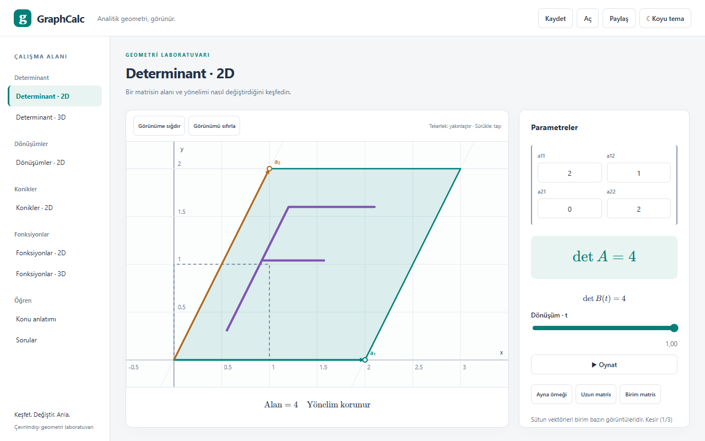
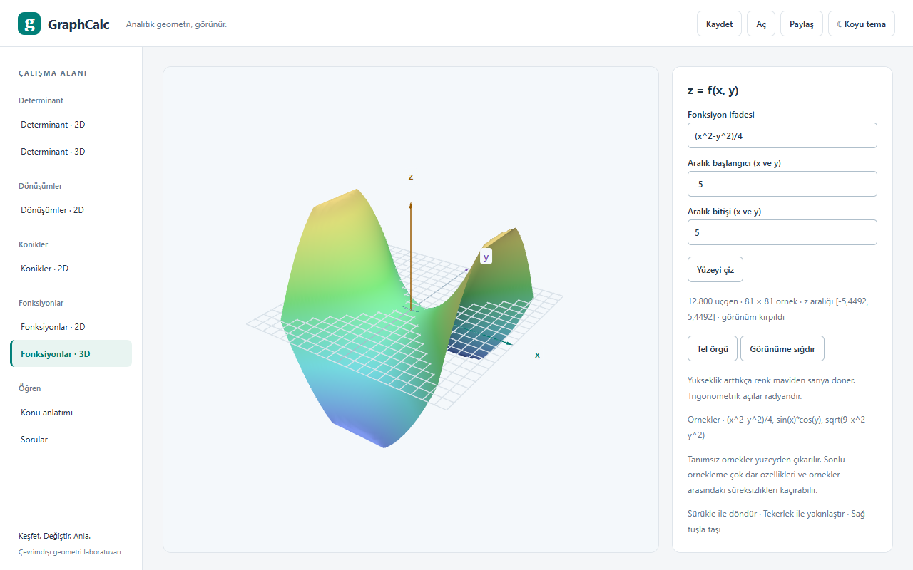
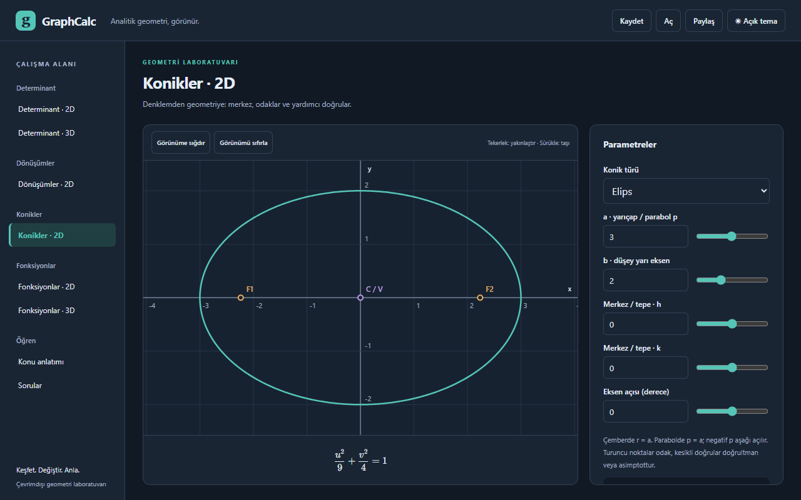

# GraphCalc

GraphCalc, ESOGÜ Matematik-Bilgisayar derslerindeki determinant, dönüşüm ve konik konularını görselleştirmek için yazdığım, Türkçe bir analitik geometri uygulamasıdır. Sürüm: 2.0.0.

## Kullanım

1. **Tarayıcıda aç:** [GraphCalc](https://7ounarion.github.io/Graphcalc/) adresini ziyaret et.
2. **Uygulama olarak yükle:** Destekleyen tarayıcılarda adres çubuğundaki yükle simgesini veya üst çubuktaki **Uygulamayı yükle** düğmesini kullan. İlk yüklemeden sonra çevrimdışı çalışır.
3. **Windows sürümünü indir:** [Releases](https://github.com/7ounarion/Graphcalc/releases/latest) sayfasından kurulum paketini veya kurulumsuz `portable.exe` dosyasını indir. Uygulama imzasız olduğundan SmartScreen ekranında **Ek bilgi → Yine de çalıştır** seçeneği gerekebilir. WebView2, Windows 10/11'de hazırdır.

## Özellikler

- 2D ve 3D determinant: kesirlerle kesin hesap, alan, hacim ve yönelim; 2D dönüşüm animasyonu.
- Nokta ve üçgen üzerinde merkezli dönme, öteleme ve işlem sırası karşılaştırması.
- Çember, elips, parabol ve hiperbol; odak, doğrultman ve asimptotlar.
- `y=f(x)` eğrileri ve `z=f(x,y)` yüzeyleri; döndürme, yakınlaştırma ve tel örgü görünümü.
- Formüllü konu anlatımları ve çözümlü sekiz soru.
- Açık/koyu tema, `.graphcalc` dosyalarıyla kaydetme/açma ve bağlantıyla paylaşma.





## Giriş ipuçları ve kısayollar

Sayısal alanlarda `90`, `-45`, `1/3`, `0,5` veya `1e3` kullanılabilir. Enter veya alandan çıkış değeri uygular; geçersiz girişte son geçerli grafik korunur. Dönme açıları derece, fonksiyonlardaki trigonometrik argümanlar radyandır.

Fonksiyonlarda ondalık ayıracı nokta, çarpma `*`, üs `^` veya `**` ile yazılır: `0.5*sin(x)`, `x^2`. `log` doğal logaritmadır. `sin`, `cos`, `tan`, `asin`, `acos`, `atan`, `sqrt`, `exp`, `log`, `log10`, `sinh`, `cosh`, `tanh`, `abs`, `pi` ve `e` desteklenir.

Grafiği sürükleyerek 2D görünümü taşıyabilir, 3D bakış açısını değiştirebilirsin. Tekerlek yakınlaştırır; 2D'de çift tıklama görünümü sıfırlar. **Görünüme sığdır** çizimi kadraja alır.

| Kısayol | İşlev |
| --- | --- |
| Enter | Sayısal girişi uygula; soru seçeneklerinde yanıtı kontrol et. |
| Ctrl+S / Cmd+S | Çalışmayı indir. |
| Ctrl+O / Cmd+O | Çalışma dosyası aç. |
| F11 / Esc | Tam ekranı aç/kapat; tam ekrandan çık. |

Dosyalara kamera, geçici animasyon durumu ve soru yanıtları eklenmez. Soru yanıtları yalnız oturumda korunur; sayfayı yenilemek yanıtları siler.

Grafikler sonlu sayıda örnekten oluşur; dar ayrıntılar veya bazı süreksizlikler kaçabilir. Sembolik cebir ve genel örtük denklem çözümü yoktur. 3D görünüm WebGL destekli tarayıcı gerektirir.

## Geliştirme

Vite ile uyumlu Node.js ve npm gerekir:

```sh
npm ci
npm run dev
```

Doğrulama ve derleme:

```sh
npm run typecheck
npm test
npm run build
npm run e2e
```

Birim testleri Vitest, tarayıcı testleri Playwright ile çalışır. Tarayıcı testleri Microsoft Edge kurulumu gerektirir. Derleme çıktısı `dist/` altındadır; `npm run preview` ile yerel olarak denenebilir.

Windows paketini oluşturmak için Rust ve [Tauri önkoşulları](https://v2.tauri.app/start/prerequisites/) kurulmalıdır:

```sh
npm run desktop:build
```

```text
src/core/        Matematik, kesirler ve ifade yorumlayıcı
src/state/       Çalışma durumu, dosya biçimi ve paylaşım
src/render/      Canvas 2D ve three.js çizimleri
src/ui/          Uygulama kabuğu ve ortak bileşenler
src/features/    Araç, ders ve soru sayfaları
src/content/     Türkçe dersler ve sorular
src/pwa/         Kurulum ve çevrimdışı önbellek
e2e/             Tarayıcı testleri ve örnek dosyalar
docs/screenshots/ README için sabit ekran görüntüleri
src-tauri/       Masaüstü paketleme
```

Katmanlar ve veri akışı için [mimari notuna](ARCHITECTURE.md) bakabilirsin.

## Lisans

[MIT](LICENSE) — Copyright (c) 2026 Yunus Köroğlu.
